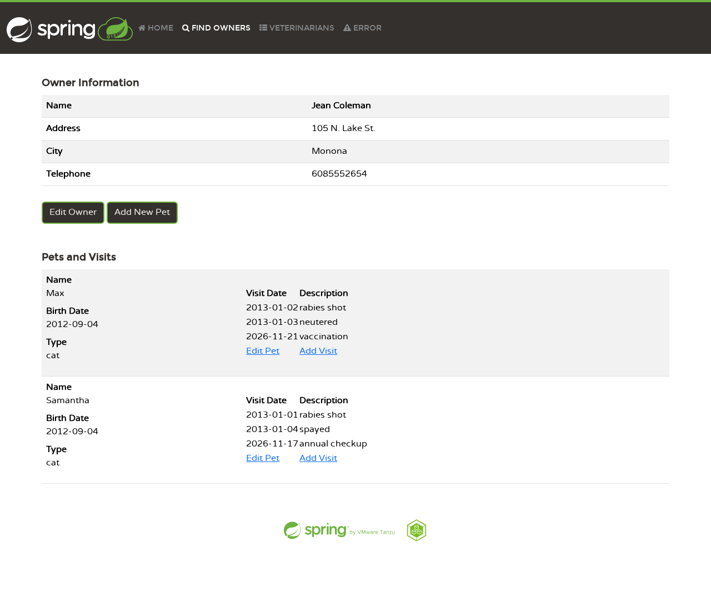
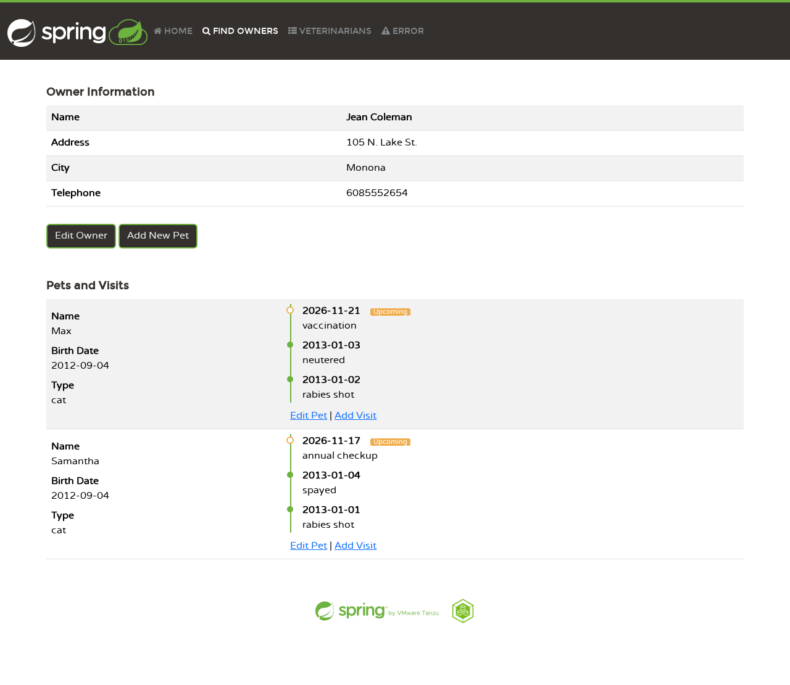

# C10·2 · Línea temporal de visitas

Un cambio de interfaz claro: en la ficha del dueño, las visitas de cada mascota pasan de una tabla a una línea temporal. Es el mismo cambio del [tutorial](../tutorial/primer-ftd.md), que lo cuenta paso a paso; aquí está la comparación.

## El pedido
[Issue #2](https://github.com/vicente-priego-aviles/meta-harness-petclinic/issues/2): «Las visitas de cada mascota se muestran como una línea temporal vertical en lugar de una tabla: la más reciente arriba, con fecha y descripción, y una marca distinta para las visitas futuras. Si una mascota no tiene visitas, un texto lo indica. Sin cambios en el modelo ni en la base de datos.»

**Lo esperado**: [carril](../ayuda/glosario.md#carril) [FTD](../ayuda/glosario.md#ftd) con [riesgo](../ayuda/glosario.md#riesgo) 1, un test que falla antes del cambio, `verify` en verde y sin intentar mostrar el veterinario de cada visita, que es de otro módulo.

## Resultado
| | Con [harness](../ayuda/glosario.md#harness) | Sin harness |
|---|---|---|
| Coste · turnos · tiempo | 0,65 USD · 17 · 2 min 9 s | 0,35 USD · 29 · 1 min 53 s |
| Carril y riesgo | FTD, riesgo 1 (recalculado al crecer el cambio) | — |
| Tests nuevos | sí, en rojo antes del código | ninguno |
| `verify` | lo ejecuta: 70 tests en verde | no lo ejecuta (pasa al lanzarlo después) |
| Revisión | encuentra un error 500 con visitas sin fecha; arreglado con test | ninguna; **el error sigue ahí** |
| Idiomas | claves en los 8 idiomas, con aviso de traducciones sin revisar | igual |
| Rama, commit y [PR](../ayuda/glosario.md#pr) | rama y commit; sin push hasta pedirlo ([PR #4](https://github.com/vicente-priego-aviles/meta-harness-petclinic/pull/4)) | sin rama ni commit |

| Antes | Después (con harness) |
|---|---|
|  |  |

## Conclusión
Las dos versiones entregan una pantalla parecida. La diferencia está en lo que no se ve: con el harness hay tests que protegen el cambio, un revisor que encontró un fallo real y un commit con su documento. Por algo menos del doble de coste.
