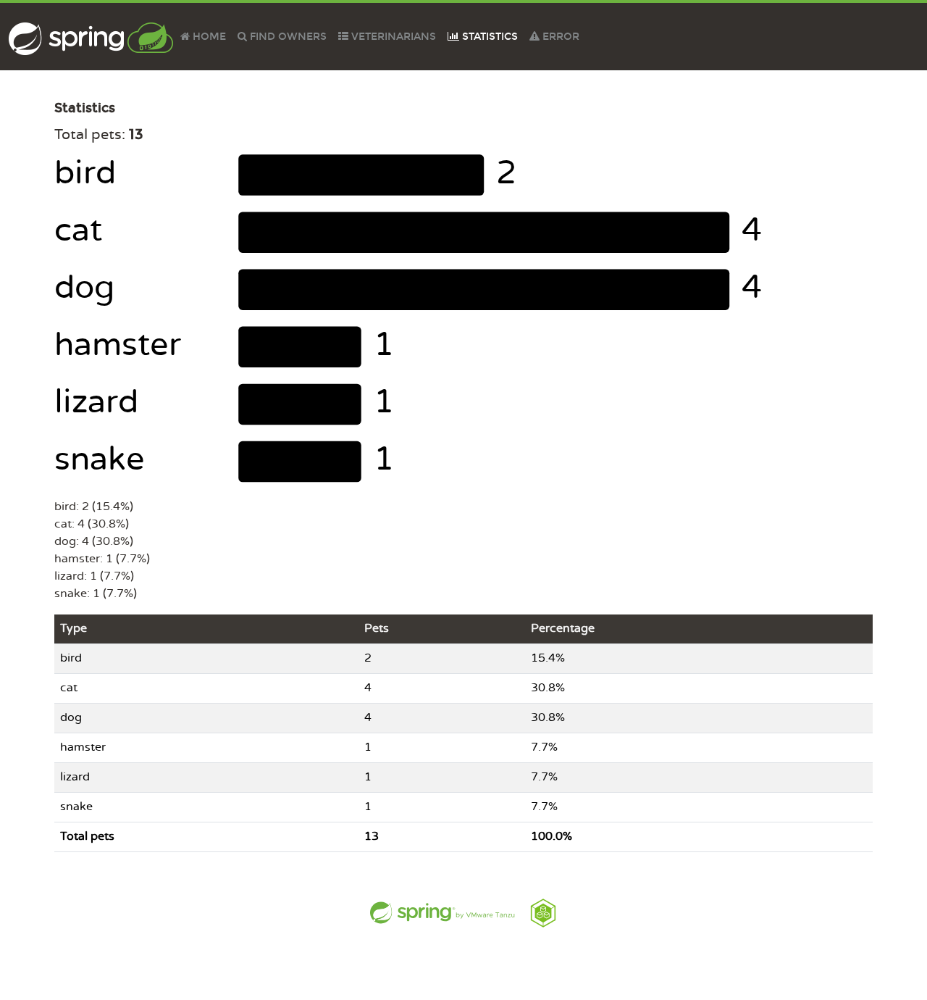
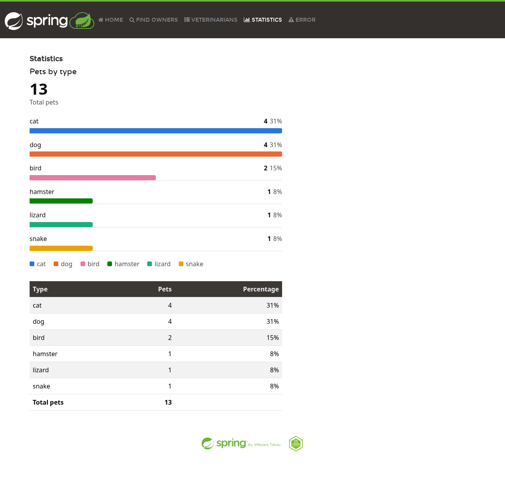

# C16·1 · Gráfico de tipos de mascota

Una página nueva con un gráfico, pedida sin decir cómo dibujarlo. Mide qué hace el agente cuando la petición deja decisiones abiertas, y si mete una librería de gráficos en el `pom.xml` (eso sería [riesgo](../ayuda/glosario.md#riesgo) 2).

## El pedido
[Issue #6](https://github.com/vicente-priego-aviles/meta-harness-petclinic/issues/6): «Nueva entrada "Estadísticas" en el menú. Muestra un gráfico con el número de mascotas de cada tipo, con su leyenda y los totales, legible en móvil. Los datos salen de la base de datos en cada visita a la página.»

## Lo que pasó con el harness
1. **Se para a preguntar** (0,10 USD). Propone [ASDD](../ayuda/glosario.md#asdd) y enumera cinco puntos abiertos: en qué módulo vive la página, SVG o librería de JavaScript, qué son «los totales», qué hacer con los tipos sin mascotas y cómo ofrecer el gráfico en texto.
2. **Spec** (≈ 0,5 USD). Con las respuestas, un [subagente](../ayuda/glosario.md#subagente) redacta la [spec](../ayuda/glosario.md#spec): 10 criterios de aceptación con su prueba y restricciones como «no tocar ningún `package-info.java`».
3. **Implementación** (≈ 1,0 USD). Gráfico en SVG dentro del módulo `owner`, sin dependencias nuevas; revisión con 10 hallazgos (9 arreglados, 1 aparcado con motivo); 74 tests en verde.
4. **Cierre** (≈ 0,4 USD). Segunda ronda de revisión limpia y verificación aprobada, con la comprobación visual a 375 px como «no ejecutada».

Sin [harness](../ayuda/glosario.md#harness), el agente decidió todo por su cuenta y entregó la página en 0,50 USD, sin spec, revisión ni commit.

## Resultado
| | Con harness | Sin harness |
|---|---|---|
| Coste | ≈ 2,0 USD en cuatro tramos | 0,50 USD · 26 turnos |
| `pom.xml` | sin cambios | sin cambios |
| Proceso | spec, plan, revisión en dos rondas, verificación | ninguno |
| Tests | 74 en verde, pero **sin ver los tests en rojo primero** | un test de integración nuevo |
| Resultado visual | **roto**: barras negras y gráfico enorme en escritorio | **correcto** |
| [PR](../ayuda/glosario.md#pr) | [#7](https://github.com/vicente-priego-aviles/meta-harness-petclinic/pull/7), sin integrar | sin rama ni commit |

| Con harness | Sin harness |
|---|---|
|  |  |

## Por qué salió mal
PetClinic guarda sus estilos en SCSS y, además, **versiona la CSS ya compilada**, que es la que se sirve; solo la regenera un perfil de Maven. El agente con harness añadió los estilos al SCSS y no a la CSS compilada, así que el gráfico salió sin ellos. Ningún test mira los estilos, y la verificación dejó la comprobación visual sin hacer. La versión sin harness editó los dos archivos, quizá por suerte.

Además, en modo no interactivo el subagente `desarrollador` no tuvo permiso para ejecutar los tests, así que el agente principal implementó él mismo y escribió tests y código a la vez. Lo dejó escrito.

## Conclusión
Ante una petición ambigua, el harness hace lo correcto, **preguntar**, y documenta cada decisión. Pero cuesta cuatro veces más y el proceso no evitó el fallo que más se ve. Lecciones para el harness: conocer los archivos generados que el proyecto versiona y comprobar de verdad lo visual antes de cerrar un cambio de interfaz.
