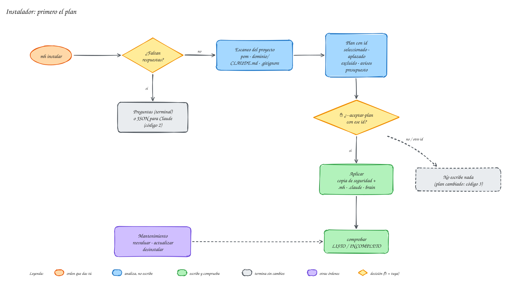
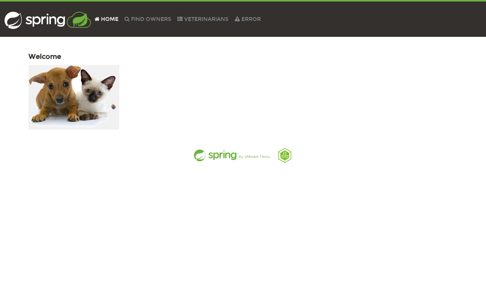
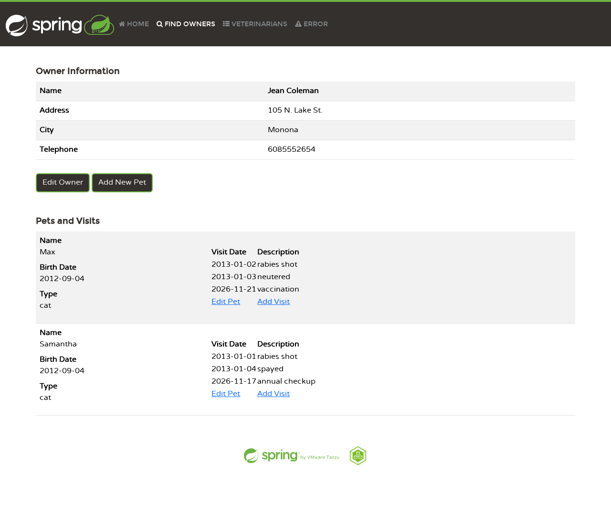
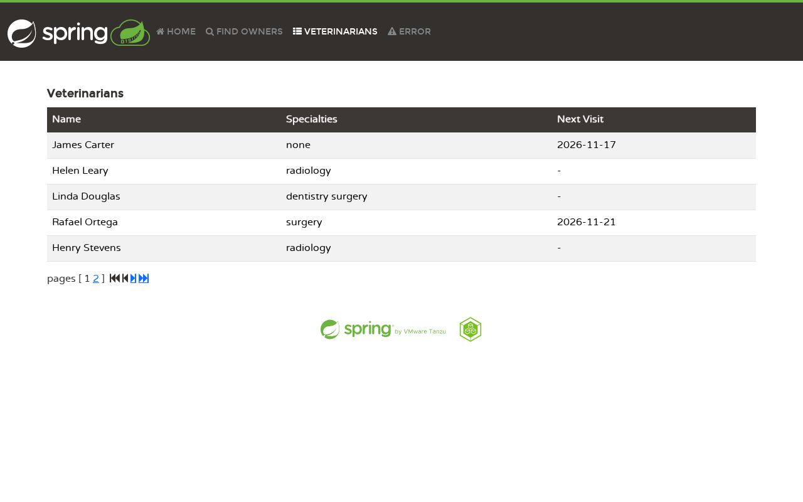

# Instalar en un proyecto

La instalación sigue el principio de **[primero el plan](../ayuda/glosario.md#primero-el-plan)**: el instalador te hace unas preguntas, analiza el proyecto y te enseña exactamente qué va a instalar y qué va a cambiar. **No escribe nada** hasta que aceptas ese plan.

{ .mh-diagrama }

<small>Pulsa el diagrama para ampliarlo.</small>

## 1. Prepara meta-harness-factory y el proyecto de ejemplo
El tutorial usa **[Spring PetClinic Modulith](https://github.com/spring-petclinic/spring-petclinic-modulith)**, una variante de la aplicación de ejemplo oficial de Spring (licencia Apache-2.0) organizada con [Spring Modulith](../ayuda/glosario.md#spring-modulith): un solo despliegue con Spring Boot y Maven, dividido en módulos con fronteras que comprueba un test. Así puedes reproducir cada paso tal cual.

```bash
git clone <url-del-repositorio> ~/meta-harness-factory
git clone https://github.com/spring-petclinic/spring-petclinic-modulith.git ~/proyectos/spring-petclinic-modulith
```
**[meta-harness-factory](../ayuda/glosario.md#meta-harness)** no necesita instalar dependencias: el instalador solo usa [Node.js](../ayuda/glosario.md#nodejs). Con tu propio proyecto, el proceso es el mismo.

### El proyecto de ejemplo
PetClinic gestiona una clínica veterinaria: dueños, sus mascotas, las visitas de cada mascota y los veterinarios. Tiene tres [módulos de aplicación](../ayuda/glosario.md#modulo-de-aplicacion):

- **`owner`**: dueños, mascotas y visitas;
- **`vet`**: veterinarios y sus especialidades; puede usar `owner`, pero no al revés;
- **`system`**: la portada, la página de error y la configuración común.

Se arranca con `./mvnw spring-boot:run` y se abre en `http://localhost:8080`:

| Portada | Ficha de un dueño | Veterinarios |
|---|---|---|
|  |  |  |

## 2. Lanza el instalador
```bash
node ~/meta-harness-factory/installer/mh.mjs instalar --carpeta ~/proyectos/spring-petclinic-modulith
```

> [!info]- ¿Qué es `mh.mjs` y por qué se ejecuta con `node`?
> **Node.js** es el entorno que ejecuta programas escritos en JavaScript fuera del navegador: para JavaScript es lo que la JVM para Java. La extensión **`.mjs`** indica un archivo JavaScript escrito como *módulo ES* (el sistema estándar de módulos, con `import`/`export`); Node.js lo ejecuta directamente, sin compilar ni instalar paquetes. *mh* son las iniciales de **meta-harness-factory**. Se eligió Node.js porque funciona igual en Linux, macOS y Windows y los [hooks](../ayuda/glosario.md#hook) de Claude Code se escriben de forma natural en él; meta-harness-factory no usa ningún paquete externo.

> [!tip] También puedes pedírselo a Claude
> En una sesión de Claude Code dentro del proyecto: «instala **meta-harness-factory** en este proyecto». El instalador le devuelve las preguntas que faltan y Claude **te las hace a ti**: tiene prohibido deducirlas del código.

## 3. Responde las preguntas
| Pregunta | Opciones | Qué cambia |
|---|---|---|
| Cómo te habla el agente | técnico · sencillo | «sencillo»: explica con analogías y sin jerga |
| Tipo de proyecto | microservicios · monolito modular · librería · otro… | ayuda a elegir módulos |
| Objetivo | una frase | la descripción del `CLAUDE.md` |
| Alcance | pequeño · creciente · complejo | pequeño = controles mínimos |
| Integración | ramas y [PR](../ayuda/glosario.md#pr) · directo en la rama principal | con ramas, las ramas base quedan protegidas |
| Convención de commits | [Conventional Commits](../ayuda/glosario.md#conventional-commits) · Conventional + gitmoji | lo que exige el hook de commits |
| Formato de rama | `57-fix-reset-cliente` · `fix/57-reset-cliente` · `fix/reset-cliente` | cómo nombra el agente las ramas |
| Idioma del código y de git | inglés · español | commits, issues y PR; queda en la constitución |
| Idioma del [brain](../ayuda/glosario.md#brain) | español · inglés | en qué idioma escribe el agente [FTD](../ayuda/glosario.md#ftd), [specs](../ayuda/glosario.md#spec) y revisiones |
| [Modo traza](../ayuda/glosario.md#modo-traza) | sí · no | ver con iconos qué [carril](../ayuda/glosario.md#carril), skills, [subagentes](../ayuda/glosario.md#subagente), reglas y hooks actúan |
| [Gestor de tareas](../ayuda/glosario.md#gestor-de-tareas) | ninguno · GitHub Issues · Jira · GitLab Issues | de dónde salen las tareas |
| (Jira) Clave del proyecto | p. ej. `RES` | búsquedas y creación de tareas |
| (con gestor) Acceso | [CLI](../ayuda/glosario.md#cli) · [MCP](../ayuda/glosario.md#mcp) | CLI recomendada: gasta menos [tokens](../ayuda/glosario.md#token) |

## 4. Lee el plan
Este es el plan **real** (resumido) para PetClinic Modulith con estas respuestas: técnico · monolito modular · creciente · ramas y PR · Conventional Commits con gitmoji · ramas `{tipo}/{issue}-{slug}` · código en inglés y brain en español · GitHub Issues por CLI.

```text
Plan de instalación 5a457843c3b3 · meta-harness-factory 0.1.0 · proyecto spring-petclinic-modulith · perfil standard

Módulos:
  ✔ nucleo   seleccionado — siempre
  ✔ java     seleccionado — build maven con Spring Boot
  ✔ ddd      seleccionado — Spring Modulith + paquetes dominio/ · variante spring-modulith
  ✔ git      seleccionado — repositorio git
  ✔ tareas   seleccionado — gestor github por CLI

Componentes:
  skills (15): brain, ftd, asdd, interrogar (manual), revision, obsidian-markdown, obsidian-bases (manual),
               defuddle (manual), excalidraw, java-spring-boot, secuencia (manual), spring-modulith, git,
               release (manual), tareas
  subagentes (11): especificador, desarrollador, revisor-correccion, revisor-tests, revisor-seguridad,
                   verificador-hallazgos, explorador, ejecutor-tests, revisor-java-spring,
                   reparador-compilacion, revisor-modulos
  reglas con paths (4): brain, java, migraciones, modulos
  riesgo 2 añadido: 4 rutas (package-info.java y API pública de cada módulo) y @ApplicationModule(, @NamedInterface

Archivos:
  crear             .mh/ — hooks, scripts, orientación y referencias
  crear             .mh.json — configuración y plan aceptado
  crear             .claude/settings.json — hooks y permisos (se conservan los tuyos)
  crear             CLAUDE.md — índice corto desde plantilla
  crear             init.sh — arranque y smoke test
  crear             brain/ — solo se crean los archivos que falten; nunca se sobrescribe
  añadir-lineas     .gitignore — .mh/tmp/, .mh/backups/ y brain/raw/sesiones/
  copiar            .claude/skills/ — 15 skills
  copiar            .claude/agents/ — 11 subagentes
  copiar            .claude/rules/ — 4 reglas

Presupuesto siempre activo:
  CLAUDE.md ~27 líneas · orientación 811 B (+ estado, máx. 1500 B al arrancar)
  10 skills automáticas (2463 caracteres de descripción) · subagentes 1702 car. · reglas siempre activas: 0

No se ha escrito nada. Para aplicar exactamente este plan:
  node ~/meta-harness-factory/installer/mh.mjs instalar --carpeta ~/proyectos/spring-petclinic-modulith … --aceptar-plan 5a457843c3b3
```

Cómo leerlo:

- **✔ seleccionado / ⏸ aplazado / ✖ excluido**, cada uno con su motivo. Lo aplazado dice qué tendría que aparecer para proponerlo (más adelante te lo avisa `mh reevaluar`, ver [mantenimiento](../ayuda/mantenimiento.md)).
- **Presupuesto [siempre activo](../ayuda/glosario.md#siempre-activo)**: lo que el agente lee en *cada* petición. Cuanto menos, más barato y más espacio útil.
- **Avisos**: problemas detectados con su solución (sin git, CLI sin sesión, `CLAUDE.md` demasiado largo, sin tests…). PetClinic Modulith no tiene ninguno.
- **El módulo ddd en su variante Spring Modulith**: el instalador ve la dependencia de Spring Modulith y trae las reglas de fronteras entre módulos (eventos, paquetes internos, el test de modularidad) en lugar de las de una arquitectura hexagonal. Por eso añade al [riesgo](../ayuda/glosario.md#riesgo) 2 los `package-info.java` y la API pública de cada módulo: cambiarlos es una decisión de arquitectura.
- El **identificador** es una huella del plan: si el proyecto o tus respuestas cambian antes de aceptarlo, no coincide y no se escribe nada. El tuyo será distinto (depende, entre otras cosas, del nombre de la carpeta).

> [!note] Tus skills y agentes no se tocan
> Si ya tienes una [skill](../ayuda/glosario.md#skill) o un agente con el mismo nombre que uno del catálogo, el plan lo marca como excluido. Tu `CLAUDE.md` recibe solo un bloque entre `<!-- mh:inicio -->` y `<!-- mh:fin -->`, y tus hooks y permisos de `settings.json` se conservan.

## 5. Acepta el plan
Copia la orden que imprime el plan (incluye tus respuestas y el identificador):
```bash
node ~/meta-harness-factory/installer/mh.mjs instalar --carpeta ~/proyectos/spring-petclinic-modulith … --aceptar-plan 5a457843c3b3
```
```text
Plan 5a457843c3b3 aplicado: 43 elementos escritos; copia de seguridad en .mh/backups/….
Estado: LISTO
Presupuesto real: CLAUDE.md 30 líneas · orientación 811 B · 10 skills automáticas (2463 car.) · 11 subagentes (1702 car.) · reglas siempre activas 0
```
Todo lo que se modifica se copia antes a `.mh/backups/`.

## 6. Qué se ha creado
```text
spring-petclinic-modulith/
├── CLAUDE.md              índice nuevo (PetClinic Modulith no tenía); en un proyecto con CLAUDE.md propio, solo se añade un bloque
├── init.sh                arranque y smoke test (la infraestructura detectada queda comentada para que la actives tú)
├── .mh.json               tu configuración: respuestas, perfil, git, tareas, riesgo
├── .mh/                   hooks, scripts (riesgo, mvnq, tarea), orientación, skills
├── .claude/
│   ├── settings.json      hooks conectados (se conservan los tuyos)
│   ├── skills/            skills elegidas (copias; funcionan igual en Windows, Linux y macOS)
│   ├── agents/            subagentes: especificador, desarrollador, revisores…
│   └── rules/             reglas que solo se cargan al tocar ciertos archivos
└── brain/                 la memoria del proyecto (bóveda de Obsidian)
```

## 7. Comprueba y haz commit
```bash
node ~/meta-harness-factory/installer/mh.mjs comprobar --carpeta ~/proyectos/spring-petclinic-modulith
git add -A && git commit -m "🔧 chore: instalar meta-harness-factory"
```
`comprobar` responde **LISTO** o **INCOMPLETO** con los motivos y mide el presupuesto real.

El `CLAUDE.md` creado es un índice corto con los módulos reales del proyecto y lo que cada uno puede usar:
```markdown
# spring-petclinic-modulith

Aplicación de ejemplo de Spring para gestionar una clínica veterinaria

Brain: brain/   (memoria del proyecto: consulta brain/wiki/index.md antes de decidir; skill `brain`)

## Mapa
| Ruta | Qué hay |
|---|---|
| `src/main/java/org/springframework/samples/petclinic/owner/` | módulo de aplicación (Spring Modulith; sin dependencias declaradas) |
| `src/main/java/org/springframework/samples/petclinic/system/` | módulo de aplicación (Spring Modulith; sin dependencias declaradas) |
| `src/main/java/org/springframework/samples/petclinic/vet/` | módulo de aplicación (Spring Modulith; solo puede usar: owner) |
| `brain/` | memoria y factoría (bóveda de Obsidian) |

## Comandos
node .mh/scripts/mvnq.mjs verify   # build y tests (salida filtrada)
node .mh/scripts/riesgo.mjs        # nivel de riesgo del cambio actual
./init.sh                          # arrancar y smoke test

## Reglas
- Carriles Responder · FTD · ASDD (ver orientación de inicio de sesión; glosario en brain/wiki/factoria/glosario.md).
- Constitución: brain/factory/constitucion.md. Qué cuenta como fallo: brain/factory/revision.md.
- Maven siempre con `node .mh/scripts/mvnq.mjs` (salida filtrada).
- Idioma: Código, commits, issues y PR en inglés; notas del brain en español.
```

## 8. Abre el brain en Obsidian
Abre la carpeta `brain/` como [bóveda](../ayuda/glosario.md#boveda) (no el repositorio entero: así no ves código). Empieza por `index.md` y revisa con el agente la **[constitución](../ayuda/glosario.md#constitucion)** (`brain/factory/constitucion.md`): es un borrador con el stack detectado que conviene completar.

## 9. Tu primera sesión
Abre Claude Code en el proyecto. Antes de tu primer mensaje, el agente ya ha recibido una orientación breve:

```text
[meta-harness-factory] Carril de cada petición (anúncialo en una línea; el usuario puede corregirlo):
- Pide información → RESPONDER …
- Cambio claro sin decisiones abiertas → FTD …
- Decisiones abiertas, ambigüedad o riesgo 2 → ASDD …
Rama: main
Último en el brain: * Creación: brain inicializado por meta-harness-factory 0.1.0.
```

Siguiente: [tu primer cambio](primer-ftd.md).
