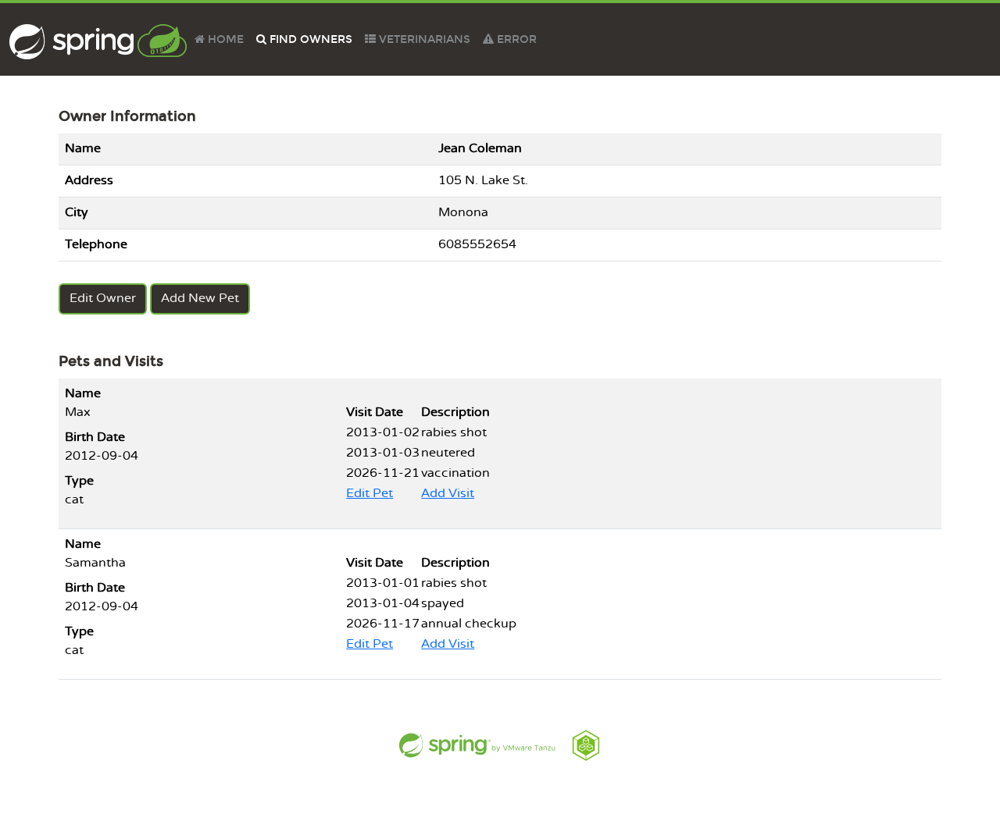
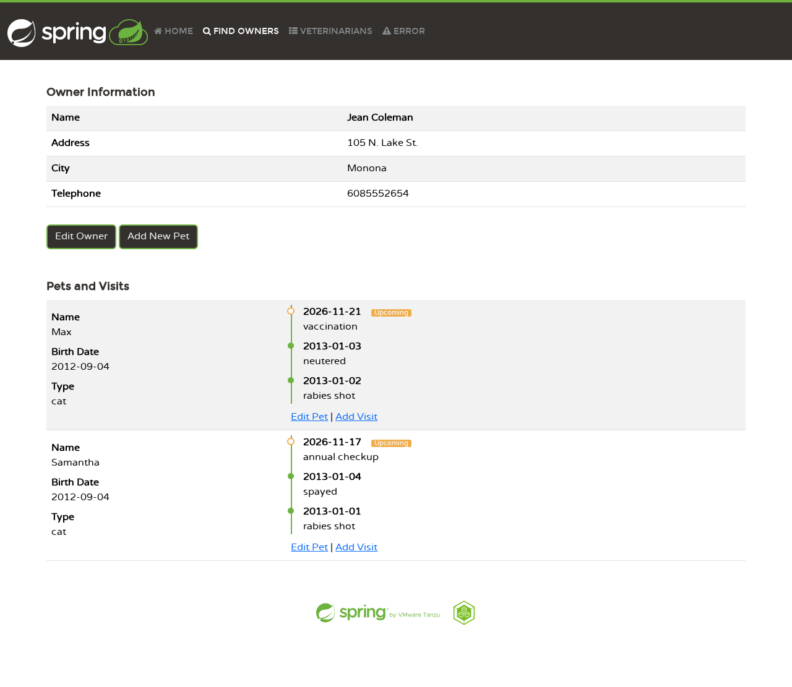
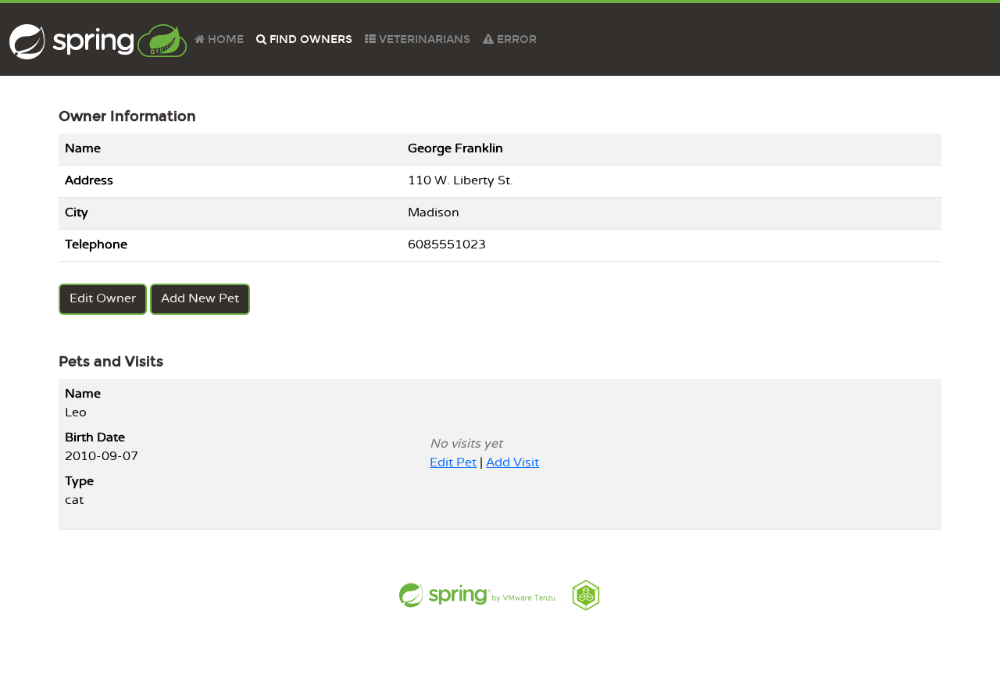

# Tu primer cambio (FTD)

**[meta-harness-factory](../ayuda/glosario.md#meta-harness)** organiza el trabajo en tres **[carriles](../ayuda/glosario.md#carril)**: caminos de trabajo con sus pasos fijos, como los carriles de una autopista. El agente elige uno según lo clara que esté la petición, te lo dice en una línea y tú puedes corregirlo. Un **[FTD](../ayuda/glosario.md#ftd)** (*Fast Track Development*, «desarrollo por la vía rápida») es el carril para cambios **claros y sin decisiones abiertas**: corregir un fallo acotado, quitar una duplicación, cambiar cómo se ve una pantalla. Aquí lo recorres entero con un cambio **real** en Spring PetClinic Modulith; todo lo que ves en esta página salió de esa ejecución.

## El cambio
En la ficha de un dueño, las visitas de cada mascota salen en una tabla, de la más antigua a la más reciente. La tarea pide una **línea temporal**: la más reciente arriba, una marca para las visitas futuras y un texto cuando una mascota no tiene ninguna. Sin tocar el modelo ni la base de datos.

| Antes | Después |
|---|---|
|  |  |

## 1. Pide el cambio
La tarea es la [issue #2](https://github.com/vicente-priego-aviles/meta-harness-petclinic/issues/2) del repositorio de pruebas. En una sesión de Claude Code dentro del proyecto basta con:

```text
Empieza la tarea #2
```

El agente lee la issue con el script `tarea`, la comenta y la enlaza a la rama. Sin [gestor de tareas](../ayuda/glosario.md#gestor-de-tareas), pega el texto de la issue en lugar del número.

## 2. Qué hace el agente
| Paso | Lo que hizo en PetClinic Modulith | Pieza |
|---|---|---|
| Lee la tarea | `node .mh/scripts/tarea.mjs ver 2` | [skill](../ayuda/glosario.md#skill) `tareas` |
| Elige carril | «Carril: FTD. El cambio está claro, solo toca la vista y no hay decisiones abiertas.» | orientación |
| Calcula el [riesgo](../ayuda/glosario.md#riesgo) previsto | `riesgo.mjs` con la plantilla → **1** (código normal); lo recalcula al crecer el cambio y sigue en 1 | script `riesgo` |
| Crea la rama | `feat/2-visit-timeline`, con el formato del proyecto (`{tipo}/{issue}-{slug}`) | skill `git` |
| Escribe el FTD | `brain/factory/ftd/2026-11-14-linea-temporal-visitas.md` | skill `ftd` |
| Test primero | `PetVisitsOrderTests` y tres casos en `OwnerControllerTests` **fallan** antes del código | [TDD](../ayuda/glosario.md#tdd) |
| Cambio mínimo | un método de solo lectura en `Pet` que ordena las visitas, la plantilla, unas reglas de CSS y dos mensajes nuevos | — |
| Controles | `node .mh/scripts/mvnq.mjs verify` → **70 tests, 0 fallos**; el agente lee 3 líneas en lugar de 891 | [`mvnq`](../tokens/mvnq.md) |
| Revisión | **un** revisor de [contexto limpio](../ayuda/glosario.md#revisor-de-contexto-limpio) (riesgo 1): `revisor-correccion` | skill `revision` |
| Evidencia y cierre | FTD con evidencia, `estado: hecho`; commit con código, tests y documentos; **sin** push | skills `ftd` y `git` |

> [!note] Algo que no estaba en la tarea
> Al añadir los dos mensajes nuevos, falló `I18nPropertiesSyncTest`: PetClinic exige las mismas claves en sus 8 idiomas. El agente amplió el alcance, lo anotó en el FTD y avisó de que **nadie nativo ha revisado las traducciones**.

> [!warning] Si el cambio fuera de riesgo 2
> Una migración de base de datos, la seguridad, el `pom.xml` o, en un proyecto con [Spring Modulith](../ayuda/glosario.md#spring-modulith), la API pública de un módulo es **riesgo 2**: el agente propone **[ASDD](../ayuda/glosario.md#asdd)**, una [spec](../ayuda/glosario.md#spec) que apruebas tú antes de tocar código. Por eso el riesgo se calcula **antes** de empezar, con los archivos que se van a tocar. Mostrar el veterinario de cada visita, por ejemplo, cruza los módulos `owner` y `vet`: queda fuera de este FTD.

## 3. El documento FTD
Así quedó, tal cual lo escribió el agente (sin el [frontmatter](../ayuda/glosario.md#frontmatter) de metadatos):

```markdown
## Intención
Tarea #2: sustituir la tabla de visitas de ownerDetails.html por una línea temporal vertical.
Sin cambios en el esquema ni en la base de datos.

## Alcance
- Pet.getVisitsNewestFirst(): visitas derivadas, orden de fecha descendente (no persistente).
- ownerDetails.html: línea temporal con fecha y descripción, marca distinta para visitas futuras
  y texto cuando no hay visitas.
- Claves i18n nuevas (noVisits, upcomingVisit) en los 8 idiomas: I18nPropertiesSyncTest exige
  las mismas claves en todos los ficheros (alcance ampliado al descubrirlo; traducciones sin
  validar por nativos).
- Visitas sin fecha (visit_date es nullable): se muestran al final y no se marcan como futuras.

## Checklist
- [x] Orden más reciente primero — prueba: PetVisitsOrderTests
- [x] Visita futura marcada y pasada sin marca — prueba: OwnerControllerTests (HTML de /owners/{id})
- [x] Mascota sin visitas muestra el texto — prueba: OwnerControllerTests
- [x] Visita sin fecha no rompe la ficha — prueba: OwnerControllerTests.testShowOwnerWithUndatedVisitStillRenders
- [x] Controles: node .mh/scripts/mvnq.mjs verify

## Evidencia
> [!success] Comportamiento
> Los tests nuevos fallaron antes del código y los de fecha nula fallaron con NPE antes de la
> corrección. Tras el cambio: mvnq verify → Tests run: 70, Failures: 0, Errors: 0, BUILD SUCCESS.
> La comprobación es con MockMvc sobre el HTML renderizado; no se ha abierto la app en un
> navegador (no ejecutado).
```

Fíjate en tres cosas: **cada punto lleva su prueba**, la evidencia dice **qué falló antes y qué pasa después**, y el agente deja escrito **lo que no comprobó** (la app en el navegador) en vez de darlo por hecho. Las capturas de arriba son esa comprobación, hecha después.

## 4. La revisión
Un [subagente](../ayuda/glosario.md#subagente) que **no vio cómo se escribió el código** revisó el cambio y encontró dos cosas:

| # | Hallazgo | Gravedad | Cierre |
|---|---|---|---|
| H1 | `Comparator.comparing(Visit::getDate)` y la marca de futura fallan si una visita no tiene fecha: la ficha del dueño daría un error 500 | alta | arreglado: test primero, y las visitas sin fecha van al final |
| H2 | El FTD decía «solo inglés», pero el cambio toca los 8 idiomas | baja | arreglado: alcance corregido en el FTD |

Con riesgo 1 revisa **uno**; con riesgo 2 revisa un panel completo y cada hallazgo se verifica contra el código antes de corregir nada. Si la mascota no tiene visitas, la ficha lo dice:



## 5. El commit
```text
✨ feat(owner): show visits as a timeline on the owner page

Render each pet's visits as a vertical timeline, newest first, with a
distinct marker for upcoming visits and a text when there are none.
Visits without a date are listed last instead of breaking the page.
i18n keys are added to every language because I18nPropertiesSyncTest
requires identical keys.

Refs: #2
```
```text
 brain/factory/ftd/2026-11-14-linea-temporal-visitas.md | 44 ++++
 src/main/java/…/owner/domain/Pet.java                  | 12 +
 src/main/resources/messages/messages*.properties (×9)  | 18 +
 src/main/resources/static/resources/css/petclinic.css  |  9 +
 src/main/resources/templates/owners/ownerDetails.html  | 29 +-
 src/test/java/…/owner/domain/PetVisitsOrderTests.java  | 59 ++++
 src/test/java/…/owner/ui/OwnerControllerTests.java     | 45 ++++
```
El código, los tests y los documentos del [brain](../ayuda/glosario.md#brain) van **en el mismo commit**. El mensaje sigue la convención del proyecto (aquí, [Conventional Commits](../ayuda/glosario.md#conventional-commits) con gitmoji, en inglés como el código); si no la siguiera, el [hook](../ayuda/glosario.md#hook) lo rechazaría y explicaría el formato. El agente **no hizo push ni abrió la [PR](../ayuda/glosario.md#pr)**: lo propuso y esperó. La PR es la [#4](https://github.com/vicente-priego-aviles/meta-harness-petclinic/pull/4).

## 6. Lo que queda en el brain
- El **FTD** con su evidencia, versionado con el código.
- Un **registro de la sesión** en `brain/raw/sesiones/` (commits, archivos, documentos tocados), escrito automáticamente al compactar o cerrar la sesión. Se queda en tu disco, fuera de git: se escribe después del último commit.
- Si salió una decisión o una lección: «recuérdalo», y el agente la guarda en el brain.

## Cuánto costó
| Parte | Turnos | Tiempo | Coste |
|---|---|---|---|
| De «Empieza la tarea #2» al commit revisado | 17 | 2 min 9 s | 0,65 USD |

Medido con Sonnet 5.5 a tarifas de la API ([qué significa ese precio](../uso/ftd.md#cuanto-cuesta)), en modo no interactivo con las ediciones aceptadas. Más datos en [ahorro de tokens](../tokens/index.md).

> [!info] El mismo pedido sin **meta-harness-factory**
> En un clon sin [harness](../ayuda/glosario.md#harness), con el texto de la issue y los mismos permisos: **0,35 USD, 29 turnos, 1 min 53 s**. Más barato, pero sin tests nuevos, sin rama, sin commit y sin revisión. Su plantilla tiene el fallo de la visita sin fecha que aquí encontró el revisor, y no ejecutó `verify` (pasa al lanzarlo después). El harness cuesta más porque hace más: tests primero, un revisor y el cierre con evidencia.

> [!success] Ya sabes trabajar con **meta-harness-factory**
> Lo siguiente: los [carriles de uso diario](../uso/index.md) en detalle, sobre todo **ASDD** para cambios con decisiones.
