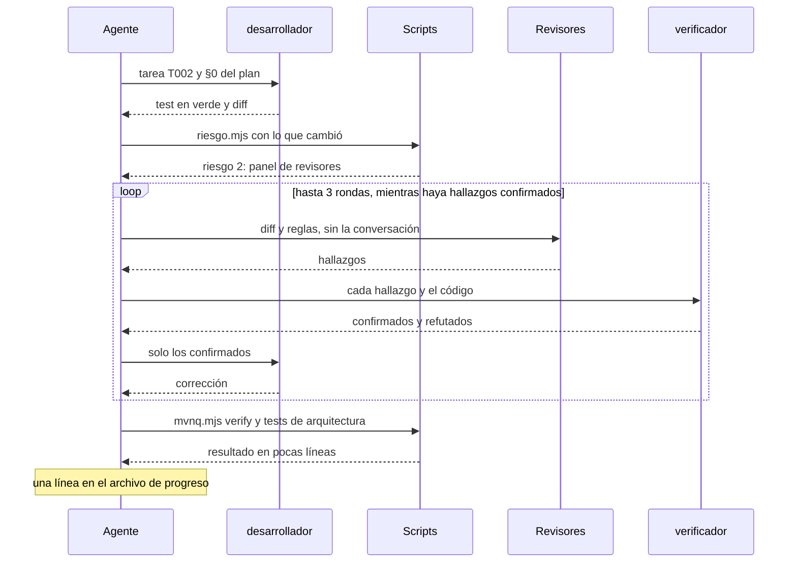

# ASDD: cambios con decisiones

**[ASDD](../ayuda/glosario.md#asdd)** (*Agent Spec Driven Development*, desarrollo guiado por especificaciones) es el [carril](../ayuda/glosario.md#carril) para cambios donde **un supuesto equivocado sale caro**: una capacidad nueva, el modelo de dominio, un contrato entre módulos, una migración, la seguridad. La regla de oro: **ningún código antes de que apruebes la [spec](../ayuda/glosario.md#spec)**.

## Los pasos
{ .mh-diagrama }

| Paso | Qué pasa | Quién | Documento en `brain/factory/` |
|---|---|---|---|
| 0 | [Constitución](../ayuda/glosario.md#constitucion) del proyecto (una vez) | tú y el agente | `constitucion.md`, `revision.md` |
| 1 | **Spec**: inventario de lo afectado, [riesgo](../ayuda/glosario.md#riesgo) y la spec | agente ([subagentes](../ayuda/glosario.md#subagente) `explorador` y `especificador`) | `specs/<tema>.md` |
| 2 | **Aclarar**: resuelves los puntos abiertos y ✋ **apruebas** | tú | la misma spec, `estado: aprobada` |
| 3 | **Plan y tareas** | agente | `planes/<tema>.md` |
| 4 | **Bucle por tarea**: [TDD](../ayuda/glosario.md#tdd), riesgo, revisión, controles | agente y subagentes | `progreso/<tema>.md` |
| 5 | **Cierre**: verificación final, evidencia y [PR](../ayuda/glosario.md#pr) (✋ lo apruebas si es riesgo 2) | agente y tú | `verificaciones/<tema>-<fecha>.md` |

## El ejemplo: el dueño elige veterinario
> [!note] Ejemplo en curso
> En Spring PetClinic Modulith, cada visita nueva recibe veterinario de forma automática: el módulo `owner` publica el [evento de aplicación](../ayuda/glosario.md#evento-de-aplicacion) `VisitBooked` y el módulo `vet` asigna el veterinario menos cargado. El caso que se va a hacer de principio a fin es **que el dueño pueda elegir veterinario al pedir la visita**, o dejar «cualquiera». Es un ASDD de libro: cambia un evento entre dos [módulos de aplicación](../ayuda/glosario.md#modulo-de-aplicacion) y el modelo de datos (riesgo 2), y deja decisiones abiertas (¿y si el elegido ya tiene la agenda llena?). Cuando esté hecho, esta página tendrá su spec, sus puntos abiertos, el reparto en GitHub Issues, capturas de la aplicación y el coste de cada paso.

### 1. La spec
Primero, un subagente barato (`explorador`, que usa un modelo de lenguaje pequeño, Haiku) hace un **inventario** de lo afectado: clases, eventos, tablas y tests. Con ese inventario, el subagente `especificador` (con Opus, el modelo más capaz y más caro) redacta la spec. Lo más valioso suele ser lo que **nadie había pedido buscar**: un fallo cercano, un contrato que se rompería o un caso que nadie había pensado.

La spec responde siempre **cuatro preguntas**:

| Pregunta | Qué se responde |
|---|---|
| 1. ¿Qué podrá hacer el usuario? | la capacidad nueva, en una frase |
| 2. ¿Qué resultado observable obtiene? | lo que se ve o se puede medir, también cuando algo falla |
| 3. ¿Qué debe respetar? | los contratos, las decisiones del brain y las reglas de la constitución que no cambian |
| 4. ¿Cómo se demuestra? | qué test prueba cada criterio |

Cada **criterio de aceptación** lleva su prueba. Un criterio tiene esta forma (ilustrativa):

```markdown
- CA1 Dado un dueño con una mascota, cuando pide una visita eligiendo a una veterinaria concreta,
  entonces la visita queda asignada a ella y no al veterinario menos cargado.
  Prueba: <el test que lo demuestra>
```

La spec incluye además el **coste de no hacerlo**, la **alternativa más barata** (y por qué no basta) y lo que queda **fuera** del cambio.

### 2. Aclarar: los puntos abiertos
El agente **no rellena huecos con supuestos**. Lo que no está claro va a una tabla de puntos abiertos, cada uno con su tipo y una recomendación:

| Tipo | Qué es |
|---|---|
| pregunta | una decisión que te toca a ti, con opciones y la recomendada |
| supuesto tomado | algo que el agente da por hecho y te enseña para que lo corrijas si no es así |
| decisión aplazada | algo que se ha visto pero queda fuera de este cambio (otra spec) |

El agente pregunta **por rondas**: en cada una, solo los puntos que ya se pueden decidir, numerados y con su respuesta recomendada redactada para que te baste con contestar «sí». Lo que se puede averiguar mirando el código o el [brain](../ayuda/glosario.md#brain) lo averigua él; a ti solo te llegan decisiones. Al responder, puede que se abran puntos nuevos, que van en la ronda siguiente. Si quieres este mismo interrogatorio fuera de ASDD (para afinar una idea o un diseño), escribe `/interrogar`.

Tú respondes, la spec se actualiza y, cuando estás conforme, la apruebas: `estado: aprobada` y la rama de trabajo. Hasta ese momento no se toca código.

### 3. Plan y tareas
Con la spec aprobada, el agente escribe el plan. Empieza con **§0 Restricciones globales, literales**: las reglas de la constitución, la pregunta 3 de la spec y las decisiones del brain, copiadas tal cual. El motivo es que el desarrollador y los revisores son subagentes que trabajan **aislados** y no ven la conversación: el §0 es lo único que seguro leen. Después vienen la arquitectura, los contratos, los datos, la estrategia de test de cada criterio y las tareas (`T001`, `T002 [P]`…; `[P]` indica que se puede hacer en paralelo). Cada tarea es una **[rebanada vertical](../ayuda/glosario.md#rebanada-vertical)**: atraviesa todas las capas que necesita (dominio, adaptador, vista, test) y se puede demostrar sola, en lugar de hacer primero toda la base de datos y luego toda la API. La columna «Depende» dice qué tareas tienen que terminar antes.

Si el proyecto tiene [gestor de tareas](../ayuda/glosario.md#gestor-de-tareas) y permiso para crear:

1. **Si el trabajo no viene de una tarea** (se lo pediste directamente en el chat), el agente crea primero una **[épica](../ayuda/glosario.md#epica)** con el resumen de la spec: problema, objetivos, criterios de aceptación y enlace.
2. Te enseña el **reparto** (cada tarea, qué entrega y qué la bloquea) y te pregunta si el tamaño y el orden te parecen bien. No crea nada hasta que lo apruebas.
3. Crea las tareas en orden, colgando de la épica (o de la tarea de origen) y marcando sus bloqueos. En GitHub quedan como [sub-issues](../ayuda/glosario.md#sub-issue) con bloqueos de verdad; en Jira, como hijas de la épica, con los bloqueos escritos en la descripción.

```bash
node .mh/scripts/tarea.mjs crear --epica --titulo "El dueño elige veterinario" --archivo epica.md
node .mh/scripts/tarea.mjs crear --titulo "T002 VisitBooked con el veterinario elegido" --archivo t002.md --padre 40 --bloqueada-por 41
```

### 4. El bucle de cada tarea
1. El subagente `desarrollador` hace la tarea con TDD.
2. El agente calcula el riesgo real y elige el panel de revisión.
3. Los revisores revisan con [contexto limpio](../ayuda/glosario.md#revisor-de-contexto-limpio) y el `verificador-hallazgos` confirma o refuta cada hallazgo contra el código.
4. Solo lo **confirmado** vuelve al desarrollador. Como mucho, tres rondas.
5. Controles: `mvnq verify` y los tests de arquitectura ([ArchUnit](../ayuda/glosario.md#archunit) o la verificación de módulos de [Spring Modulith](../ayuda/glosario.md#spring-modulith)).
6. Una línea en `progreso/<tema>.md`, un archivo al que solo se añade: tarea, resultado, evidencia y siguiente paso.

Cada subagente recibe solo lo que necesita (la tarea, el §0 del plan, el diff) y no ve la conversación. Así trabajan aislados, como en este diagrama; las flechas continuas son peticiones y las discontinuas, respuestas:



Lo que necesita tu criterio va a la **[cola de decisiones](../ayuda/glosario.md#cola-de-decisiones)**. Si es `bloqueante`, el agente para y espera; si es `revisar-después`, sigue y lo revisas después.

### 5. Cierre
El agente comprueba **cada criterio de aceptación con su prueba** y lo deja en `verificaciones/`. Un control que no se ejecutó aparece como «no ejecutado», nunca como «pasado». Después abre el PR. Si es de riesgo 2, el [hook](../ayuda/glosario.md#hook) solo deja subirlo con la spec aprobada y la revisión aprobada para esa rama, y el PR espera tu aprobación.

## Cuánto cuesta
Una spec de este tamaño es lo más caro de **[meta-harness-factory](../ayuda/glosario.md#meta-harness)**, porque la redacta el modelo más capaz:

| Versión | Coste |
|---|---|
| Primera prueba: el especificador exploraba el servicio entero por su cuenta | 2,58 USD |
| Con el inventario previo hecho por un modelo pequeño | **1,05 USD (−59 %)** |

<small>Prueba anterior en otro proyecto Spring Boot; se completará con el ciclo entero del ejemplo de PetClinic Modulith.</small>

Por eso el paso 1 empieza siempre con el `explorador`. Comparado con lo que cuesta descubrir en producción un fallo grave que nadie había buscado, es barato. Más datos en la sección de [tokens](../tokens/index.md).

> [!tip] El modo autopiloto
> Si quieres que el agente avance sin preguntarte entre pasos, díselo («sigue en autopiloto»). Seguirá trabajando y dejará en la cola de decisiones lo que necesite tu criterio. La aprobación de la spec y la del PR de riesgo 2 siguen siendo tuyas.
